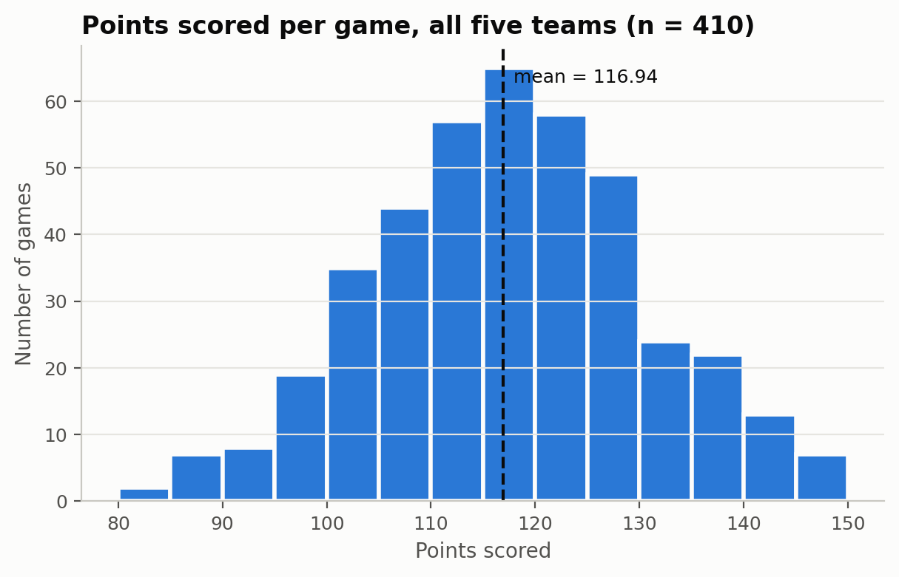
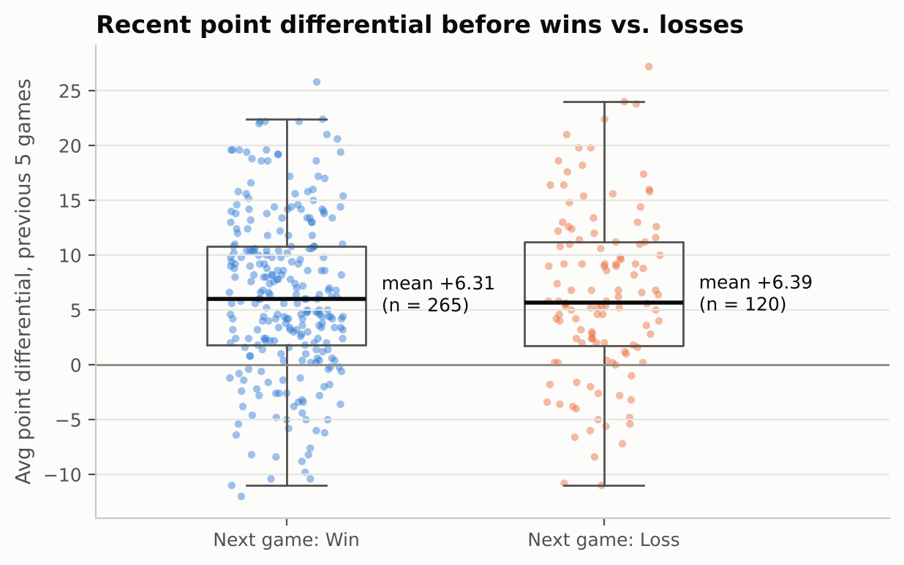
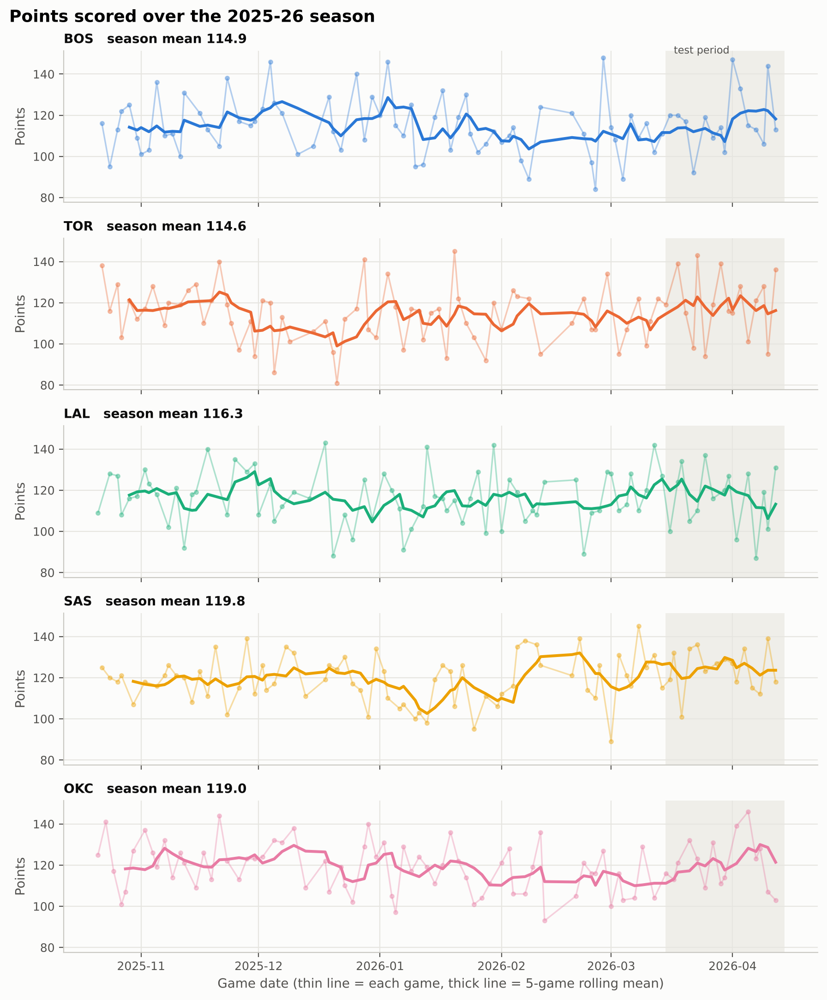

# DATA Folder Metadata

This file documents the data used in the **Predicting NBA Game Outcomes Using Recent Team Performance** project: where it came from, how it was processed, its known limitations, and the meaning of every column in each dataset. It describes the datasets in this folder as produced by `SCRIPT/01_clean_and_engineer_features.py` and `SCRIPT/03_arima_forecasts.py`, which together turn the five raw team game logs into the final modeling table used for logistic regression.

## Data Summary

The dataset covers 410 regular-season games played during the 2025–26 NBA season by five teams: the Boston Celtics (BOS), Toronto Raptors (TOR), Los Angeles Lakers (LAL), San Antonio Spurs (SAS), and Oklahoma City Thunder (OKC), 82 games each. Each row is a single team's performance in a single game (one box score per team per game, so a game between two of the five teams appears twice, once from each team's perspective). After excluding each team's first five games, which lack a full five-game history, the final modeling dataset contains 385 observations.

Each observation pairs a team's box-score statistics for one game (points, point differential, rebounds, turnovers, home/away) with rolling averages of that same team's previous five games and a binary win/loss outcome. The project goal is to use those previous-five-game averages, plus a home-court indicator, to predict whether the team wins its next game.

Six CSV files are provided, representing successive stages of the pipeline:

- `BOS_game_logs_2025-26.csv`, `TOR_game_logs_2025-26.csv`, `LAL_game_logs_2025-26.csv`, `SAS_game_logs_2025-26.csv`, `OKC_game_logs_2025-26.csv` — the five raw, per-team game logs as downloaded, 82 games each.
- `all_games_clean.csv` — all 410 games stacked together, validated, and augmented with five-game rolling averages (`avg_points_last5`, `avg_point_diff_last5`, `avg_rebounds_last5`, `avg_turnovers_last5`) and `rest_days`. Each team's first five games have missing rolling averages because no prior five-game window exists yet.
- `model_dataset.csv` — `all_games_clean.csv` filtered down to the 385 games with a complete five-game history, with a chronological `split` column (`train`/`test`) added.
- `arima_forecasts.csv` — for every game, a one-step-ahead ARIMA forecast of that team's points in that game, generated using only that team's games played strictly before it (see Provenance).
- `final_analysis_dataset.csv` — `model_dataset.csv` joined with the ARIMA forecast column (`arima_points_forecast`), used to compare plain logistic regression against logistic regression augmented with a time-series forecast.

## Provenance

The five raw team game logs were obtained from BoxScore Lab, a third-party provider of downloadable NBA game statistics derived from official NBA game records. Each file contains one row per game played by that team during the 2025–26 regular season (82 games), with columns for the date, matchup, opponent, home/away status, final result, points scored, opponent points, point differential, rebounds, and turnovers.

`SCRIPT/01_clean_and_engineer_features.py` loads and stacks the five raw files, then:

1. Parses game dates and converts the `home` field from text (`"True"`/`"False"`) to a 0/1 indicator.
2. Checks for missing values, duplicate team/date rows, and internal consistency (that `point_diff` equals `points - opponent_points`, that `result` agrees with the sign of `point_diff`, and that the `home` flag agrees with the matchup text). Any row that fails these checks is dropped rather than imputed, since imputing from later games would leak future information.
3. Computes `win` (1 = win, 0 = loss) and a per-team `game_number`.
4. Computes five-game rolling averages of points, point differential, rebounds, and turnovers using `shift(1)` before `rolling(5)`, so a game's own result never contributes to its own features. `rest_days` (days since the team's previous game) is also computed but is a descriptive column only, not a model feature.
5. Writes the full 410-game table to `all_games_clean.csv`, then drops each team's first five games (no complete five-game history) to produce the 385-game `model_dataset.csv`, labeling games on or after 2026-03-15 as `test` and everything before as `train` (a chronological ~80/20 split). Because the split is by date, both sides of a game between two of the five selected teams always land in the same split, preventing one matchup from being split across train and test.

`SCRIPT/03_arima_forecasts.py` then builds the time-series component: for each team, an Augmented Dickey-Fuller test on the training-period points series confirmed stationarity (d = 0 for all five teams), an ARIMA(p, 0, q) order was selected by lowest total AIC across all five teams' training series (searched over p, q ∈ {0, 1, 2}), and a walk-forward (expanding-window) procedure refits that ARIMA model on each team's games 1..k−1 to forecast game k, so no game's forecast ever uses that game or any later game. These forecasts are written to `arima_forecasts.csv` and merged into `model_dataset.csv` to produce `final_analysis_dataset.csv`.

## License

The code in this repository (scripts and analysis) is released under the MIT License (see `LICENSE` at the repository root).

The underlying game data is not covered by that license. The raw game logs were obtained from BoxScore Lab under a Creative Commons Attribution 4.0 (CC BY 4.0) license, which permits reuse and adaptation with attribution; BoxScore Lab is credited here as the dataset provider. The original statistics are themselves derived from official NBA game records and remain subject to NBA.com's terms of use. This dataset and the derived files in this folder are intended for academic research and analysis only, not for commercial redistribution or sports betting.

## Ethical Statements

- **Academic use only.** Win-probability models of this kind can be misused for sports betting. This project and dataset are intended strictly for academic analysis and should not be used as a basis for wagering or other financial decisions.
- **No personal or private information.** All data is public, team-level game statistics; no individual player data, injuries, or personal information is included or analyzed.
- **Small, hand-selected sample.** Only five teams (chosen by the group, not randomly) and one season are included, and the teams vary considerably in strength. This limits generalizability to the rest of the league and may inflate apparent model accuracy for stronger or more consistent teams.
- **Duplicate matchup observations.** Games between two of the five selected teams appear twice in the data, once from each team's perspective, so observations are not fully independent. The chronological train/test split keeps both sides of any such matchup in the same partition to avoid leaking information across the split.
- **Omitted factors.** The dataset does not account for injuries, rest beyond `rest_days`, opponent strength, or roster/trade changes, all of which materially affect real NBA outcomes; conclusions should be read as describing patterns in recent box-score performance only, not causal drivers of winning.
- **Season- and team-specific scope.** Findings are limited to the 2025–26 season and the five selected teams and should not be assumed to generalize to other seasons, teams, or leagues.

## Data Dictionary

### Raw team logs (`<TEAM>_game_logs_2025-26.csv`)

| Column | Description | Uncertainty / Notes |
|---|---|---|
| `season` | NBA season label (`2025-26`). | Constant across all rows. |
| `team` | Three-letter abbreviation of the team the row belongs to (BOS, TOR, LAL, SAS, OKC). | |
| `game_date` | Date the game was played. | Used to order games chronologically and define the train/test split. |
| `matchup` | Text description of the matchup, e.g. `BOS vs. PHI` (home) or `BOS @ NYK` (away). | Used to cross-check the `home` flag. |
| `opponent` | Three-letter abbreviation of the opposing team. | Opponents may include teams outside the five selected teams. |
| `home` | Whether the team played at home (`True`/`False` in the raw files; converted to 1/0 in processed files). | |
| `result` | Game result from the team's perspective (`W` or `L`). | Converted to the binary `win` column downstream. |
| `points` | Points scored by the team. | |
| `opponent_points` | Points scored by the opponent. | |
| `point_diff` | `points - opponent_points`. | Checked for internal consistency during cleaning. |
| `rebounds` | Total rebounds recorded by the team (offensive + defensive). | |
| `turnovers` | Turnovers committed by the team. | |

### `all_games_clean.csv` (adds to the raw columns above)

| Column | Description | Uncertainty / Notes |
|---|---|---|
| `win` | Binary target: 1 = win, 0 = loss. | Derived from `result`. |
| `game_number` | The team's game index within the season (1–82). | |
| `avg_points_last5` | Mean `points` over the team's previous five games. | Missing (NaN) for each team's first five games. |
| `avg_point_diff_last5` | Mean `point_diff` over the team's previous five games. | Missing for each team's first five games. |
| `avg_rebounds_last5` | Mean `rebounds` over the team's previous five games. | Missing for each team's first five games. |
| `avg_turnovers_last5` | Mean `turnovers` over the team's previous five games. | Missing for each team's first five games. |
| `rest_days` | Days since the team's previous game. | Descriptive only; not used as a model feature. Missing for each team's first game. |

### `model_dataset.csv` (adds to `all_games_clean.csv`)

| Column | Description | Uncertainty / Notes |
|---|---|---|
| `split` | Chronological partition: `train` (before 2026-03-15) or `test` (on/after 2026-03-15). | ~80/26% train, ~19.74% test; both sides of a same-day matchup always share a split. |

Rows with any missing `avg_*_last5` value (each team's first five games) are excluded, leaving 385 of the original 410 rows.

### `arima_forecasts.csv`

| Column | Description | Uncertainty / Notes |
|---|---|---|
| `team` | Team abbreviation. | |
| `game_date` | Date of the game being forecast. | |
| `points` | Actual points scored (for comparison against the forecast). | |
| `arima_points_forecast` | One-step-ahead ARIMA forecast of `points`, fit using only that team's games strictly before this one. | NaN for each team's first five games, which lack enough history to fit/forecast. |
| `arima_fallback` | True if the ARIMA fit failed for this game and the forecast fell back to the mean of games played so far. | |
| `prev5_points_avg` | Simple previous-five-game average of points, used as a baseline forecast for comparison with ARIMA. | Missing for each team's first five games. |
| `arima_order` | The (p, d, q) order selected for the ARIMA model (chosen once, by lowest total AIC across all five teams' training series; d is fixed at 0 because all teams' series tested stationary). | Same value repeated on every row. |

### `final_analysis_dataset.csv`

Contains every column from `model_dataset.csv` plus `arima_points_forecast` from `arima_forecasts.csv`, joined on `team` and `game_date`. This is the table used to compare a logistic regression model using only box-score rolling averages against one that also includes the ARIMA forecast as a predictor.

## Explanatory Plots

`OUTPUT/fig01_points_distribution.png` — shows the distribution of points scored per game across the five selected teams. Scoring is roughly centered in the high 110s, which is consistent with the ~116.9 points/game average found during exploratory analysis. This distribution motivates using points (and its five-game rolling average) as a feature, since meaningful game-to-game variation exists for the model to learn from.

`OUTPUT/fig02_last5_point_diff_by_outcome.png` — compares each team's previous-five-game average point differential (`avg_point_diff_last5`) before wins versus before losses. The two distributions are very similar (means of roughly +6.3 to +6.4 in both cases), indicating that recent point differential alone is a weak single-variable predictor of the next game's outcome. This supports the project's decision to combine multiple rolling statistics (points, point differential, rebounds, turnovers) and a home-court indicator in a multivariate logistic regression rather than relying on any one feature.

`OUTPUT/fig03_points_time_series_by_team.png` — plots each team's points scored over the course of the season as a time series, with the train/test split date marked. This illustrates the per-team scoring trends and game-to-game volatility that the ARIMA component (`SCRIPT/03_arima_forecasts.py`) models directly, and shows why a single fixed ARIMA order, chosen by total AIC across all five teams, was a reasonable simplification given the broadly similar fluctuation patterns across teams.

