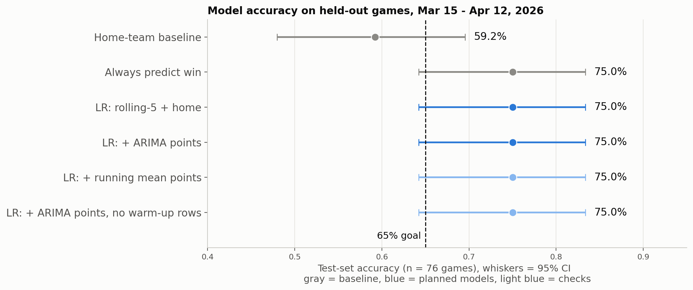
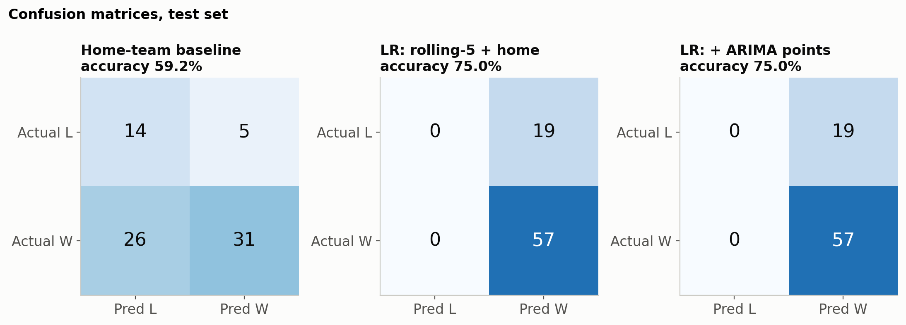

# Predicting NBA Game Outcomes Using Recent Team Performance

**Group:** The Good Guys  
**Group Leader:** Nathan Nguyen  
**Group Members:** Keegan Jewell, Brian Ryu  
**Course:** DS 4002 — University of Virginia  
**Project:** Project 2 — MI3: Perform Analysis

## Project Overview

**Research question:** Can an NBA team's performance over its previous five games help predict whether it will win its next game?

We study five teams in the **2025–26 NBA regular season**: Boston Celtics (BOS), Toronto Raptors (TOR), Los Angeles Lakers (LAL), San Antonio Spurs (SAS), and Oklahoma City Thunder (OKC). We construct predictors from each team's previous five games, use ARIMA to forecast its next-game points, and compare logistic regression classifiers against simple baselines.

**Predefined success criterion:** At least **65% accuracy** on a chronologically held-out test set, and better accuracy than predicting that the home team wins.

## Software and Platform

The repository contains **Python 3 scripts** that can be run from a terminal or a Python-capable environment such as Google Colab. The scripts use paths relative to their own locations, so run them from the repository root as shown below. GitHub is used for version control and documentation.

Required third-party Python packages:

| Package | Use |
|---|---|
| `pandas` | Read, clean, transform, and save game data |
| `numpy` | Numerical calculations |
| `matplotlib` | Plots and model-result figures |
| `seaborn` | Exploratory statistical graphics |
| `scikit-learn` | Standardization, logistic regression, and classification metrics |
| `statsmodels` | ARIMA, stationarity testing, and confidence intervals |

Package versions are **not pinned** in this repository. To record versions in your environment, run `python -m pip freeze`. Reproducing identical results may require matching the original environment, whose exact package versions are not recorded.

## Repository Map

```text
NBA-Game-Outcome-Prediction/
├── README.md                              # Project overview and reproduction guide
├── LICENSE.md                             # MIT license for repository code
├── DATA/
│   ├── README.md                          # Provenance, licensing, ethics, and data dictionary
│   ├── BOS_game_logs_2025-26.csv          # Original Boston game log
│   ├── LAL_game_logs_2025-26.csv          # Original Los Angeles game log
│   ├── OKC_game_logs_2025-26.csv          # Original Oklahoma City game log
│   ├── SAS_game_logs_2025-26.csv          # Original San Antonio game log
│   ├── TOR_game_logs_2025-26.csv          # Original Toronto game log
│   ├── all_games_clean.csv                # Combined games and engineered features
│   ├── model_dataset.csv                  # Eligible observations and split labels
│   ├── arima_forecasts.csv                # One-step-ahead points forecasts
│   └── final_analysis_dataset.csv         # Modeling data joined to ARIMA forecasts
├── SCRIPTS/
│   ├── 01_clean_and_engineer_features.py  # Validation, rolling features, train/test labels
│   ├── 02_exploratory_analysis.py         # Exploratory figures
│   ├── 03_arima_forecasts.py              # ARIMA selection and walk-forward forecasts
│   ├── 04_logistic_regression.py          # Baselines, classifiers, metrics, figures
│   └── plot_style.py                      # Shared plotting configuration (helper module)
└── OUTPUT/
    ├── fig01_points_distribution.png
    ├── fig02_last5_point_diff_by_outcome.png
    ├── fig03_points_time_series_by_team.png
    ├── fig06_model_accuracy_comparison.png
    ├── fig07_confusion_matrices.png
    └── model_comparison.csv               # Test results and confidence intervals
```

The directory is named **`SCRIPTS`**, singular. The project uses `.py` files, not a single `.ipynb` notebook. All processed CSVs are saved directly inside `DATA/`; plots and the comparison table are saved directly inside `OUTPUT/`.

## Data and Preprocessing

The five original game logs were obtained from **BoxScore Lab**, using NBA game statistics. Each of the five teams has 82 game-level rows, for **410 team-game observations**. Games between two selected teams can appear twice, once from each team's perspective.

The cleaning script checks missing values, duplicate team/date entries, and consistency of game outcomes, scores, and home/away indicators. It sorts each team's games chronologically and computes the following features using **only the five games before the target game**:

| Feature | Definition |
|---|---|
| `avg_points_last5` | Mean points scored in previous five games |
| `avg_point_diff_last5` | Mean point differential in previous five games |
| `avg_rebounds_last5` | Mean rebounds in previous five games |
| `avg_turnovers_last5` | Mean turnovers in previous five games |
| `home` | Home-game indicator, 1 for home and 0 for away |
| `win` | Target outcome, 1 for win and 0 for loss |
| `arima_points_forecast` | Forecast points scored in the target game, using earlier games only; included in enhanced model |

Rolling averages use a one-game shift before the five-game window, avoiding direct leakage from the game being predicted. The first five games of each team cannot have complete rolling histories and are excluded. This leaves **385 eligible observations**.

The actual chronological partition in `DATA/model_dataset.csv` is:

| Partition | Game dates | Observations | Share |
|---|---|---:|---:|
| Training | October 30, 2025 – March 14, 2026 | 309 | 80.26% |
| Testing | March 15, 2026 – April 12, 2026 | 76 | 19.74% |

All observations from the same calendar date receive the same partition, including both perspectives of games between selected teams. The scripts calculate the split based on **March 15, 2026**, not a random split.

For the complete field-by-field dictionary, source provenance, data license statement, and ethical considerations, see [`DATA/README.md`](DATA/README.md).

## Reproducing the Analysis

### 1. Download the repository

Use GitHub's **Code → Download ZIP** option and extract it, or run:

```bash
git clone https://github.com/nathannguyen13/NBA-Game-Outcome-Prediction.git
cd NBA-Game-Outcome-Prediction
```

### 2. Set up Python and install dependencies

Use Python 3 with `pip`. From the repository root, run:

```bash
python -m pip install pandas numpy matplotlib seaborn scikit-learn statsmodels
```

On systems where `python` does not point to Python 3, substitute `python3`. The five original CSV files are already included in `DATA/`; no external download is required for the committed dataset.

### 3. Run the scripts in order

Run these commands **from the repository root**:

```bash
python SCRIPTS/01_clean_and_engineer_features.py
python SCRIPTS/02_exploratory_analysis.py
python SCRIPTS/03_arima_forecasts.py
python SCRIPTS/04_logistic_regression.py
```

- **Script 01** reads the five raw CSVs, validates them, computes leakage-free rolling features, and writes `DATA/all_games_clean.csv` and `DATA/model_dataset.csv`.
- **Script 02** reads those files and writes three exploratory plots (`fig01`, `fig02`, `fig03`) to `OUTPUT/`.
- **Script 03** checks stationarity using the Augmented Dickey–Fuller test, compares ARIMA(p,0,q) specifications with p and q from 0 to 2 using training-data AIC, and produces expanding-window, one-step-ahead forecasts in `DATA/arima_forecasts.csv`. It also prints forecast error comparisons against the previous-five-game mean.
- **Script 04** joins forecasts to the modeling data, saves `DATA/final_analysis_dataset.csv`, trains and evaluates the classifiers, and writes `OUTPUT/model_comparison.csv`, `fig06_model_accuracy_comparison.png`, and `fig07_confusion_matrices.png`.

`SCRIPTS/plot_style.py` is imported by other scripts; **do not run it separately**. Script 03 repeatedly fits ARIMA models and may take longer than the other steps.

### 4. Check the outputs

After execution, inspect `OUTPUT/model_comparison.csv` for the model metrics and the PNG files for exploratory and evaluation figures. The scripts also print preprocessing counts, ARIMA diagnostics, and evaluation summaries to the console. Running the scripts regenerates the processed data and output files.

## Modeling Approach

**Baselines:** The home-team baseline predicts a win for home games and a loss for away games. The majority-class baseline predicts a win for every game, because wins are the more common outcome in the training data.

**Logistic regression:** The original classifier uses the four previous-five-game rolling averages plus `home`. The enhanced classifier adds `arima_points_forecast`. Each classifier is implemented as a `StandardScaler` followed by scikit-learn `LogisticRegression(max_iter=1000)`, fitted on the training partition and evaluated on the held-out test partition.

**ARIMA:** The script selects one ARIMA(p,0,q) order across the five teams using training data only. It refits on the history available before each forecasted game, so the game's own points are not used to forecast that game. The ARIMA output is a **points forecast**, not a direct win/loss prediction.

## Results

Results below are taken from the committed [`OUTPUT/model_comparison.csv`](OUTPUT/model_comparison.csv). The test set contains **76 team-game observations**.

| Model | Correct / 76 | Test accuracy | 95% Wilson interval |
|---|---:|---:|---:|
| Home-team baseline | 45 | 59.21% | 47.98%–69.56% |
| Always predict win | 57 | 75.00% | 64.22%–83.37% |
| Logistic regression: rolling-five + home | 57 | 75.00% | 64.22%–83.37% |
| Logistic regression: rolling-five + home + ARIMA points | 57 | 75.00% | 64.22%–83.37% |

Both logistic regression models meet the predefined **65% accuracy** target and exceed the **59.21% home-team baseline**. However, **both logistic regression models predicted a win for every test observation**, producing exactly the same accuracy as the trivial always-predict-win baseline. **Adding ARIMA did not improve win/loss classification accuracy.** Consequently, this result does **not** establish that the rolling statistics or ARIMA forecasts provide useful classification skill beyond the majority-class prediction for this test set.

The test sample is small and the reported intervals are wide; differences should not be overinterpreted. The win-heavy composition of the selected teams also affects how meaningful raw accuracy is as a measure of predictive performance.

### Figures

**Points distribution:**  


**Previous-five-game point differential by outcome:**  


**Points scored over time by team:**  


**Model accuracy comparison:**  


**Confusion matrices:**  


## Limitations and Ethics

This analysis includes only five selected teams in one season; results may not generalize to the NBA overall. The dataset contains duplicate perspectives for some matchups, and team-game observations are not fully independent. The models omit opponent strength, injuries, roster changes, and other game context. A high win rate among the chosen teams allows a trivial always-win rule to achieve 75% test accuracy. ARIMA is fit to relatively short individual-team scoring histories, and its scoring forecasts do not necessarily improve game-outcome prediction.

The project uses public team-level statistics and no private personal data. The analysis is for educational research, **not wagering or financial decision-making**. Repository code is MIT-licensed under [`LICENSE.md`](LICENSE.md); the game data have separate provenance and licensing considerations described in [`DATA/README.md`](DATA/README.md).

## References

[1] Y. Li, L. Wang, and F. Li, “A data-driven prediction approach for sports team performance and its application to National Basketball Association,” *Omega*, vol. 98, art. 102123, 2021. https://doi.org/10.1016/j.omega.2019.102123

[2] “The application of artificial intelligence techniques in predicting game outcomes of professional basketball league: A systematic review,” *PLOS ONE*, 2025. https://doi.org/10.1371/journal.pone.0326326

[3] National Basketball Association, “NBA Stats.” https://www.nba.com/stats/

[4] Scikit-learn developers, “LogisticRegression.” https://scikit-learn.org/stable/modules/generated/sklearn.linear_model.LogisticRegression.html

[5] BoxScore Lab, “NBA Data Downloads.” https://boxscorelab.com/

[6] Statsmodels developers, “ARIMA.” https://www.statsmodels.org/stable/generated/statsmodels.tsa.arima.model.ARIMA.html

## Project Status

**MI2:** Dataset establishment and analysis plan completed.  
**MI3:** Preprocessing, exploratory analysis, ARIMA forecasting, logistic regression evaluation, and result files are present in the repository. Exact dependency versions are not recorded; the steps above describe how to regenerate the committed outputs.

